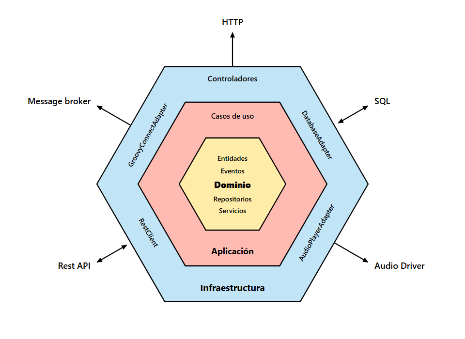

# Arquitectura Hexagonal de Groovy (Puertos y Adaptadores)

Este documento describe la arquitectura hexagonal (*Ports and Adapters Architecture*) implementada en el ecosistema **Groovy**, garantizando un desacoplamiento estricto entre el núcleo del negocio (música, reproducción, listas, letras sincronizadas) y las tecnologías de infraestructura (motores de audio nativos, bases de datos locales, APIs externas y clientes de usuario).

---

## 📐 Diagrama de Arquitectura

  

> Formato vectorial disponible: [`hexagonal_architecture.svg`](hexagonal_architecture.svg)

---

## 🧩 Capas del Sistema

### 1. Núcleo de Dominio (`Dominio`) — Hexágono Central (Amarillo)
El núcleo de la aplicación contiene los conceptos más puros del dominio musical y las reglas de negocio independientes de cualquier framework o tecnología externa.

* **Entidades (`Entities`)**:
  * `Song`: Modelo canónico de pista con metadatos, duración, URLs de audio, covers en alta resolución y formatos soportados.
  * `Album`: Representación de álbumes, metadatos oficiales y enlaces a carátulas animadas en movimiento (*Motion Artwork*).
  * `Artist`: Información del artista, biografía y discografía relacionada.
  * `Playlist`: Colecciones de canciones organizadas por el usuario o generadas por el sistema.
  * `LyricLine` / `LyricWord`: Estructuras de letras sincronizadas a nivel de línea y sílaba (*syllable-level sync*).
  * `User`: Información de perfil y sesión del usuario.

* **Eventos de Dominio (`Domain Events`)**:
  * `PlaybackEvent`: Cambios de estado en la reproducción (`Playing`, `Paused`, `Buffering`, `Completed`).
  * `TrackChangedEvent`: Transición de pista actual en la cola.
  * `QueueUpdatedEvent`: Modificaciones en el orden o elementos de la lista de reproducción en cola.
  * `SyncDeviceEvent`: Señales de sincronización transmitidas a través de Groovy Connect.

* **Repositorios (Puertos de Salida / Contratos)**:
  * `ILibraryRepository`: Contrato para la lectura y persistencia de canciones, álbumes y playlists.
  * `IAudioRepository`: Contrato para la interacción con el motor de audio.
  * `ICacheRepository`: Contrato para el almacenamiento temporal y en memoria de pistas y carátulas.
  * `ISearchRepository`: Contrato para búsqueda y deduplicación inteligente de contenido musical.

* **Servicios de Dominio (`Domain Services`)**:
  * `AutoDjService`: Lógica algorítmica para generar transiciones y selección inteligente de pistas continuas.
  * `RecommendationService`: Cálculo de recomendaciones basadas en géneros, artistas y patrones de escucha.
  * `LrcTtmlParser`: Parser de alto rendimiento para archivos de letras sincronizadas en formatos `.lrc` y `.ttml`.
  * `PaletteService`: Extracción dinámica de paletas de color a partir de las carátulas para adaptar la interfaz visual.
  * `BpmAnalyzerService`: Análisis de tempo y ritmo para mezclas y transiciones suaves.

---

### 2. Capa de Aplicación (`Aplicación`) — Hexágono Intermedio (Salmón)
Orquesta el flujo de datos hacia y desde las entidades de dominio, e implementa los casos de uso específicos solicitados por los usuarios.

* **Casos de Uso (`Use Cases`)**:
  * **Reproducción y Control de Cola (`PlayerProvider`)**: Carga de pistas, pre-calentamiento (*pre-warming*), control de volumen, avance de stanzas y saltos de pista.
  * **Sincronización de Letras en Vivo**: Vinculación de letras temporizadas con la posición de reproducción en sub-segundos (120Hz).
  * **Gestión de Biblioteca y Favoritos (`LibraryProvider`)**: Marcado de favoritos, creación de playlists personalizadas e historial de reproducción.
  * **Sincronización Multi-dispositivo (`Groovy Connect`)**: Conexión bidireccional para control remoto en tiempo real entre Windows, Android, Web, Linux y macOS.
  * **Descargas y Modo Offline (`OfflineService`, `DeviceDownloadService`)**: Descarga resiliente de audio y metadatos para escuchar sin conexión a internet.
  * **Autenticación y Perfil (`AuthProvider`)**: Inicio de sesión mediante credenciales o Google OAuth y sincronización en la nube.

---

### 3. Capa de Infraestructura (`Infraestructura`) — Hexágono Exterior (Celeste)
Contiene los adaptadores que comunican el sistema con el mundo exterior (interfaz gráfica, APIs de terceros, almacenamiento y hardware).

* **Controladores (`Driving Adapters`)**:
  * **Flutter UI**: Pantallas nativas multiplataforma (`NowPlayingScreen`, `HomeScreen`, `LibraryScreen`, `AlbumScreen`, etc.).
  * **React Web Client**: Aplicación web SPA moderna para navegación de escritorio y móvil (`react-website`).
  * **Groovy Backend API**: Servidor Node.js con endpoints RESTful (`/api/music`, `/api/auth`, `/api/library`, `/api/download`).
  * **Integraciones del Sistema**: Soporte para Android Auto, controles en la barra de tareas de Windows, teclas multimedia y Discord Rich Presence.

* **DatabaseAdapter (`Persistencia & Almacenamiento`)**:
  * `LibraryDatabaseService`: Base de datos SQLite local para persistencia rápida de metadatos, favoritos y caché offline.
  * `StorageService`: Almacenamiento seguro de configuraciones y tokens de sesión.

* **AudioPlayerAdapter (`Motor de Audio`)**:
  * `AudioHandler`: Adaptador de bajo nivel que conecta con `just_audio` (Android / iOS) y `libmpv` (Windows / Linux / macOS) para decodificación nativa sin pérdida y reproducción gapless.

* **RestClient (`Streaming & APIs de Terceros`)**:
  * `YoutubeService` / `YtdlpService`: Extracción dinámica de flujos de audio y CDN.
  * `LrclibService`: Cliente REST para la base de datos abierta de letras sincronizadas LRCLIB.
  * `AppleMusicArtworkService`: Resolución de carátulas de estudio de ultra alta definición (1400×1400) y video motion artwork (`.m3u8`).
  * `GroovyApiService`: Cliente HTTP para el backend en la nube de Groovy.

* **GroovyConnectAdapter (`Message Broker & Sockets`)**:
  * `GroovyConnectService`: Comunicación en tiempo real a través de WebSockets y sockets LAN locales para transmisión instantánea de comandos y estado de reproducción entre dispositivos.

---

## 🔄 Flujo de Datos y Dependencias

En cumplimiento de la **Regla de Dependencia** de la Arquitectura Hexagonal:
1. Las dependencias apuntan **hacia adentro**: La capa de *Infraestructura* depende de la *Aplicación*, y la *Aplicación* depende del *Dominio*.
2. El **Dominio no conoce** nada acerca de Flutter, SQLite, WebSockets, YouTube o librerías externas.
3. Cualquier componente de infraestructura (por ejemplo, cambiar el motor de audio o la base de datos local) puede ser reemplazado creando un nuevo adaptador que implemente la interfaz del puerto correspondiente, sin alterar una sola línea de lógica del dominio musical.
